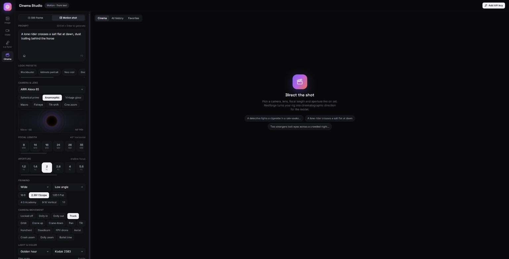
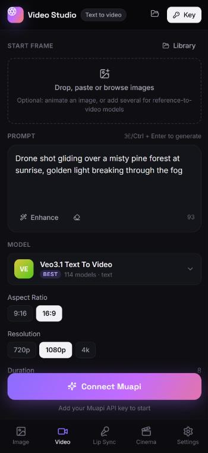

# Reelforge

**An open-source, self-hosted AI creative studio.** Generate and edit images, make videos from text or a start frame, create talking portraits and lip-synced clips, and direct cinematic shots with real camera controls. Powered by [Muapi](https://muapi.ai) (430+ models behind one API key).

Runs in the browser or as a desktop app (Windows / macOS / Linux). Your API key, upload history and generation history stay on your machine.



<p align="center">
  
  <br><sub>On mobile: studios move to a bottom tab bar and the Generate button stays within reach.</sub>
</p>

## Studios

| Studio | What it does |
| --- | --- |
| **Image** | Text → image. Add one image to edit or restyle it. Add several to use multi-reference models (Nano Banana, GPT Image, Seedream, Flux Kontext, Qwen Edit…). Upscalers and background removal are in the same list. |
| **Video** | Text → video, or image → video from a start frame. Shows an end-frame slot for models that support it. Add several images to use reference-to-video models. |
| **Lip Sync** | Portrait + audio → **talking portrait** (OmniHuman, Kling Avatar, InfiniteTalk…). Video + audio → **lip-synced video** (Sync, LatentSync…). You can record audio in the app. |
| **Cinema** | A virtual camera rig: body, lens type, **focal length** (8–300 mm with live FOV), **aperture** (f/1.2–f/22), shot size, angle, camera movement, lighting, color grade, grain and aspect ratio, plus look presets. The rig is turned into cinematographer language and added to your prompt. Works for stills and motion. |

### How it behaves

- **Automatic text/upload mode.** With no image attached you see text-to-X models. Drop, paste (Ctrl/⌘ + V) or pick an image and the studio switches to image-input models. Your last model choice is remembered for each mode.
- **Multi-image inputs.** With 2+ images, only models that accept image arrays are listed (and only those whose limit covers your count). Drag thumbnails to reorder; refer to them as `@1`, `@2`… in your prompt.
- **Controls come from the model's schema.** Aspect ratio, duration, resolution, seed, audio toggles and so on are rendered from each model's parameters. Values are remembered per model.
- **History.** Every generation is saved with its prompt, parameters, cost and request ID. Jobs that are still running keep polling after a page reload. You can favorite, run again, delete and export history.
- **Upload history.** The original files are kept locally (IndexedDB), so you can reuse them later. Muapi's hosted upload URLs expire after about 1 hour, so Reelforge re-uploads stale files when needed.
- **Full-resolution downloads.** The original output file is streamed from Muapi's CDN with no recompression. "Use as input" sends any output back into a studio.

## Quick start

Requires **Node 18+** and a [Muapi API key](https://muapi.ai) (Dashboard → API Keys).

```bash
npm install
npm run dev          # http://localhost:5173 (hot reload)
```

### Self-host (browser)

```bash
npm run build
npm start            # http://127.0.0.1:8080
HOST=0.0.0.0 PORT=8080 npm start   # expose on your network
```

The server has **no runtime dependencies**. It serves `dist/` and proxies `/muapi/*` to `https://api.muapi.ai`. A proxy is needed because Muapi does not accept browser CORS requests.

Docker:

```bash
docker build -t reelforge .
docker run -p 8080:8080 reelforge
```

> Each visitor enters their own key, stored in their browser. The server never stores keys; it forwards the `x-api-key` header for each request. If you expose it publicly, put it behind authentication. Anyone who can reach it can use it as a proxy to Muapi with their own key.

### Desktop app

```bash
npm run desktop      # build + launch Electron
npm run dist         # package an installer into ./release
```

The desktop app runs the same local server on `127.0.0.1:47821`. A fixed port keeps your history across restarts. Your API key is encrypted with the OS keychain (Electron `safeStorage`).

#### Releases

[GitHub Actions](.github/workflows/desktop.yml) builds installers for Windows (`.exe`), macOS (`.dmg`, Intel and Apple Silicon) and Linux (`.AppImage`):

- **Push a version tag** (`git tag v0.2.0 && git push --tags`) to build all three and publish them on a [GitHub Release](https://github.com/amineboukrout/reelforge/releases).
- **Run it manually** from the Actions tab to get the installers as downloadable artifacts, without a release.

The installers are **unsigned**, so Windows SmartScreen and macOS Gatekeeper will warn on first launch. On macOS, right-click the app and choose **Open**. To sign them, add `CSC_LINK` / `CSC_KEY_PASSWORD` (plus Apple notarization secrets) to the repo's secrets.

## Adding models

**1. Re-sync from Muapi (recommended).** The built-in catalog is generated from Muapi's OpenAPI spec:

```bash
npm run sync-models               # fetch https://api.muapi.ai/openapi.json
npm run sync-models -- spec.json  # or use a local copy
```

New Muapi models appear in the right studio, with their controls, after a rebuild.

**2. Custom models without rebuilding.** Edit `public/models.custom.json` (or `dist/models.custom.json` on a deployed server), or paste JSON in **Settings → Custom models** (saved in the browser). A custom model with the same `id` as a built-in one overrides it, so you can also fix or rename built-ins.

```json
{
  "models": [
    {
      "id": "my-endpoint",               // POST https://api.muapi.ai/api/v1/my-endpoint
      "name": "My Model",
      "category": "i2v",                 // t2i | i2i | t2v | i2v | avatar | lipsync | enhance
      "tier": "best",                    // optional: fast | balanced | best
      "inputs": {
        "prompt": { "field": "prompt", "required": true },
        "image":  { "field": "images_list", "multi": true, "max": 4, "required": true },
        "endImage": { "field": "last_image" },
        "audio":  { "field": "audio_url" },
        "video":  { "field": "video_url" }
      },
      "params": [
        { "key": "aspect_ratio", "label": "Aspect ratio", "type": "enum", "options": ["16:9", "9:16"], "default": "16:9" },
        { "key": "duration", "label": "Duration", "type": "int", "min": 3, "max": 10, "default": 5 },
        { "key": "generate_audio", "label": "Audio", "type": "bool", "default": true },
        { "key": "negative_prompt", "label": "Negative prompt", "type": "string" }
      ]
    }
  ]
}
```

(The comments are for explanation only; the real file must be plain JSON.) Param `type` is one of `enum`, `int`, `number`, `bool` or `string`.

**3. Featured ordering and defaults** are set in the `FEATURED` lists in `src/lib/catalog.ts`.

## Project layout

```
server/handler.mjs      Muapi proxy + /dl download proxy (shared by dev, server, desktop)
server/index.mjs        zero-dependency static server for self-hosting
electron/               desktop shell (main + sandboxed preload, safeStorage key store)
scripts/sync-models.mjs OpenAPI → src/catalog/models.generated.json
src/lib/muapi.ts        submit / poll / upload client
src/lib/catalog.ts      catalog + custom models
src/lib/cinema.ts       camera rig → prompt language
src/studios/            Image, Video, Lip Sync, Cinema + shared engine (mode switching)
src/store/app.ts        state, job runner, local history (IndexedDB)
```

## Privacy & security

- Your API key is sent only in the `x-api-key` header, to Muapi, through your own local server.
- `/dl` only fetches public `http(s)` URLs. Localhost and private-network addresses are rejected.
- The desktop renderer runs sandboxed with context isolation and no Node access. External links open in your browser, and only microphone permission is granted.

## License

MIT. Reelforge is an independent project, not affiliated with Muapi or any model provider. You are responsible for following each model provider's terms.
